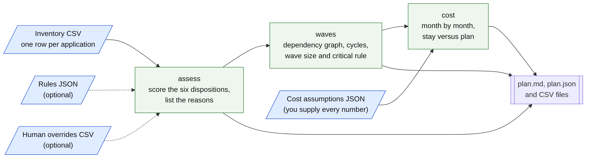
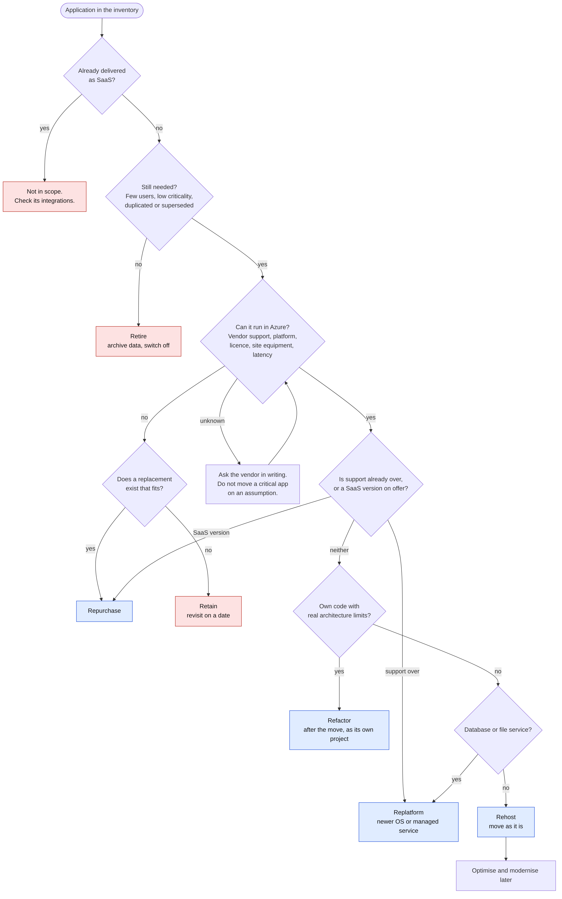

# azure-cloud-migration-planner

[](https://github.com/pJijesh/azure-cloud-migration-planner/actions/workflows/test.yml) [](LICENSE)  

**Problem:** groups with a mixed legacy estate (old Windows servers, packaged ERP, in-house code, shop floor equipment, SaaS they forgot about) need to decide what happens to each application, in what order, and what it costs, but the answers usually live in a spreadsheet that nobody can explain and a business case nobody can reproduce.

**For:** IT leaders and architects planning a move to Azure, and the finance and programme people who have to challenge the plan.

**Demonstrates:** a transparent rule-based disposition per application with reasons, dependency-driven migration waves with cycle detection, a month by month three year cost comparison with sensitivity and an explicit list of what is not modelled, and a practical guide set (assessment questions, landing zone checklist, cutover and rollback, why migrations stall, presenting to a CFO), all in a small, tested, dependency-free Python tool.



> **Planning aid only.** This tool is not a substitute for Azure Migrate discovery and assessment, a vendor quote, or the judgement of application owners. Cost numbers are only as good as the inputs you supply, and the tool contains no Azure prices. All companies, people, systems and figures in the examples are fictional, and the example cost assumptions are illustrative placeholders. This is general information, not professional or legal advice.

## What it does

Given an inventory CSV with one row per application, it:

- **assesses** each application and assigns one of six dispositions (rehost, replatform, refactor, repurchase, retire, retain). Each disposition gets a score from rules you can read and edit, and each decision comes with a plain-English reason list, a runner-up, a confidence level, flags and next steps. Close calls, ties and unconfirmed vendor support are sent for human review. Human decisions can override the rules and are recorded beside them.
- **sequences waves** from the dependency column: topological order, circular dependencies found and reported with a concrete loop, a wave size limit, critical applications kept out of the first wave, shared services first, and warnings for links to applications that stay on premises or are being retired.
- **compares cost** over three years (or any horizon from one to ten) for staying as is against following the plan, from a cost assumptions file you supply. It reports totals, yearly totals, the final-year recurring cost, break-even month, an optional discounted view, plus and minus 20 percent sensitivity on the key assumptions, and warnings about what is not modelled (egress, licensing changes, skills, network and more).
- **plans**: runs all three and writes a Markdown plan with CSV and JSON files.

## Quick start

Requires Python 3.10 or later. No third-party packages.

```bash
pip install -e .            # optional: gives you the migration-planner command
python -m migration_planner plan examples/inventory.csv \
  --assumptions examples/cost-assumptions.json \
  --as-of 2026-11-11 --out output
```

Open `output/plan.md`. The committed copy of that output is in [`examples/output/`](examples/output/).

To use it on your own estate:

```bash
python -m migration_planner show-assumptions-template > my-assumptions.json   # every number is empty
# fill in each value from your own quotes, contracts and Azure Migrate output
python -m migration_planner plan my-inventory.csv --assumptions my-assumptions.json --as-of 2026-11-11
```

The cost step refuses to run while any required input is empty, so a number never appears that nobody chose.

Each step also runs alone, and later steps accept the earlier step's JSON:

```bash
python -m migration_planner assess inventory.csv --as-of 2026-11-11 --out out
python -m migration_planner waves  out/assessment.json --max-wave-size 6 --out out
python -m migration_planner cost   out/assessment.json --assumptions my-assumptions.json --out out
python -m migration_planner show-rules > rules.json      # copy, edit, pass back with --rules
```

## Inventory columns

`app_id, name, owner, business_criticality (1 to 5), users, technology, os_or_platform, end_of_support_date (YYYY-MM-DD), vendor_supported_in_cloud (yes, no, unknown), data_sensitivity (low, medium, high, restricted), dependencies (app ids separated by semicolons), current_annual_cost, change_frequency (none, low, medium, high), licence_model, notes`. An optional extra column `azure_annual_cost_estimate` lets you bring in a per-application estimate from a proper assessment. Bad input stops the run with every problem listed, with line numbers, and exit status 2. The [assessment guide](docs/assessment-guide.md) lists the questions that fill each column.

## Results on the worked example

A fictional manufacturing and distribution group with 42 applications (ERP, finance, file servers, a legacy application on an unsupported operating system, SaaS already in use, two circular dependencies, three applications with unknown vendor support). See the [worked example](docs/worked-example.md) and [`plan.md`](examples/output/plan.md).

| Disposition | Applications |
|---|---|
| rehost | 21 |
| replatform | 9 |
| refactor | 1 |
| repurchase | 1 |
| retire | 2 |
| retain | 8 (three of them already SaaS) |

19 applications need a human decision. 32 are placed in 8 waves, with two circular groups reported. On the **illustrative** cost assumptions, following the plan costs GBP 534,260 more than staying over three years, yet GBP 61,832 less to run in year three, and does not break even within the horizon. The point of the example is how to read a result like that, not what a real estate would show.

## Documentation

| Document | What it covers |
|---|---|
| [Assessment guide](docs/assessment-guide.md) | The questions to ask for each application, mapped to the inventory columns |
| [The six Rs](docs/six-rs.md) | Decision rules for each disposition, when each is wrong, and the mapping to Microsoft's eight terms |
| [Disposition rules](docs/disposition-rules.md) | How scoring works and the full rule table (generated from the rules file), and how to change it |
| [Wave planning](docs/wave-planning.md) | The sequencing method, warnings and honest limits |
| [Cost model](docs/cost-model.md) | Month by month method, every input, sensitivity, and what is not modelled |
| [Landing zone readiness checklist](docs/landing-zone-readiness.md) and [CSV](docs/landing-zone-readiness.csv) | 61 items across identity, network, governance, security, monitoring, backup and disaster recovery, cost management and more |
| [Cutover and rollback template](docs/cutover-and-rollback.md) | Entry criteria, runbook, acceptance tests, failure criteria and rollback |
| [Why migrations stall](docs/why-migrations-stall.md) | Common causes, how they show, and what helps |
| [Presenting to a CFO](docs/cfo-business-case.md) | How to structure and defend the business case |
| [Worked example](docs/worked-example.md) | The fictional estate, results and what a reviewer should challenge |
| [Sources and verification](docs/sources-and-verification.md) | What was checked against Microsoft guidance, when, and what was not |



## How it is built

```text
.
├── README.md, LICENSE, CONTRIBUTING.md, pyproject.toml
├── migration_planner/
│   ├── cli.py                     Commands: assess, waves, cost, plan, show-rules, show-assumptions-template
│   ├── inventory.py               CSV reader and validation (all problems reported, with line numbers)
│   ├── rules.py, default_rules.json   Rule loading, validation and the default rules
│   ├── assess.py                  Scoring engine, reasons, confidence, human overrides
│   ├── graph.py                   Cycle detection (iterative Tarjan) and shortest loop path
│   ├── waves.py                   Wave sequencing and the Mermaid diagram
│   ├── assumptions.py, default_assumptions_template.json   Cost inputs: loading and validation
│   ├── cost.py                    Month by month model, break-even, sensitivity, warnings
│   ├── report.py, serialise.py, pipeline.py   Markdown, CSV and JSON output
├── docs/                          Guides, checklist (md and csv), diagrams (mmd, svg, png)
├── examples/                      Fictional estate, illustrative assumptions, overrides, generated output
├── tools/build_docs.py            Regenerates the rule table and the checklist page from data
├── tests/                         pytest suite
└── .github/workflows/test.yml     Tests on Python 3.10 to 3.13, docs check, quick start smoke test
```

## Design choices

- **Rules, not a black box.** Scores are plain integers added by named rules with reasons. Anyone can see why an application got its disposition and change the rule they disagree with. The rules file is JSON, validated on load.
- **Humans decide.** Retirements, unknown vendor support, close calls and ties are flagged for review, and an overrides file records the human decision beside the rule's proposal.
- **No numbers nobody chose.** The cost template is empty and the command refuses to run on it. Illustrative numbers carry a banner in every output.
- **Dependencies first, with the trade-off stated.** Strict ordering leaves a window of hybrid running. The plan counts the links crossing the boundary after each wave, and an option allows dependencies to share a wave.
- **Cycles are grouped, not hidden.** A loop is reported and moved as one unit.
- **Deterministic.** Everything is sorted, there are no timestamps or absolute paths, and the end-of-support date test uses an explicit `--as-of` date. A test compares the example output byte for byte with a fresh run, and another checks the order of input rows does not matter.
- **Standard library only.** Nothing to install, nothing to patch.

## Limitations

- **A planning aid, not a substitute** for Azure Migrate discovery and assessment, a vendor quote, a proof of concept, or the judgement of owners. It does not read Azure Migrate exports, inspect any system, or call any network service.
- **Cost numbers are only as good as the inputs.** The default way to estimate Azure cost is a run cost factor applied to today's cost, which is crude. Replace it with per-application estimates through the optional `azure_annual_cost_estimate` column.
- **What is not modelled:** data egress and transfer, licensing changes and reuse, skills and staffing, network circuits and bandwidth beyond one figure, commitment discounts and support plans, right-sizing, growth and seasonality, backup and disaster recovery differences, contract and data centre exit costs, disruption and downtime, tax and accounting treatment. Some can be added through `other_costs`.
- **Scores, thresholds and wave limits are design choices**, not Microsoft guidance. They are documented, adjustable and no substitute for review.
- **Dependencies come from the inventory.** If they are wrong, the waves are wrong. Check them against network flow data.
- **Wave size counts applications, not effort**, and the tool has no calendar: change freezes, financial close and team capacity are for you to overlay.
- **Keyword matching is simple.** Rules read the `technology`, `notes` and platform text for words such as "PLC" or "superseded". It misses synonyms and can match loosely. Use the vocabulary in the assessment guide or edit the keyword lists.
- **English and GBP defaults** in the examples. The currency is a label only.

## Verification status

- **Run and passing:** the full test suite (see below), the quick start command, the CLI end to end on the worked example, and a byte-for-byte comparison of the committed example output with a fresh run. The generated documentation check passes.
- **Diagrams:** the three Mermaid diagrams were rendered with Mermaid CLI and the images were looked at to check they are legible.
- **Microsoft guidance and product names** were checked against Microsoft Learn and lifecycle pages on 11 November 2026 (see [sources and verification](docs/sources-and-verification.md)), and a few service names were not on the pages fetched. Re-check before relying on any detail.
- **Not verified:** nothing has been run against an Azure tenant, Azure Migrate or a real inventory. The GitHub Actions workflow has been written and its commands run locally, but the workflow itself has not yet run on GitHub. Python 3.10 to 3.13 are in the CI matrix, but the suite was run locally on one Python version only.
- **No real data:** every name, owner, number and date in the examples is invented or illustrative.

## Tests

```bash
python -m pip install -e ".[dev]"
python -m pytest -q
python tools/build_docs.py --check
```

The suite covers inventory validation and error messages, known dispositions on small fixtures (with exact scores), tie-breaking, overrides, rule file validation, topological order, cycle detection and loop paths, wave size and critical-application rules, cost arithmetic checked against hand calculations (including break-even, inflation, parallel running, stranded cost and hardware refresh), sensitivity, assumption validation, determinism, the CLI end to end on the worked example, and repository hygiene (links, generated documents, diagrams, no dashes or forbidden strings).

## Roadmap

Planned, not promised. Order and timing change with other work.

- **Next:** Release v1.0 after a final read-through; Add landing zone checklist import
- **Then:** Add sensitivity charts; Add wave risk scoring
- **Later:** Add cloud cost management checklist; Release v1.1

## Licence

MIT. See [LICENSE](LICENSE). Contributions are welcome; see [CONTRIBUTING](CONTRIBUTING.md).

## Author

Built by Puliyappottammal Jijesh, an IT manager. [LinkedIn](https://www.linkedin.com/in/pjijesh) | [GitHub](https://github.com/pJijesh)
