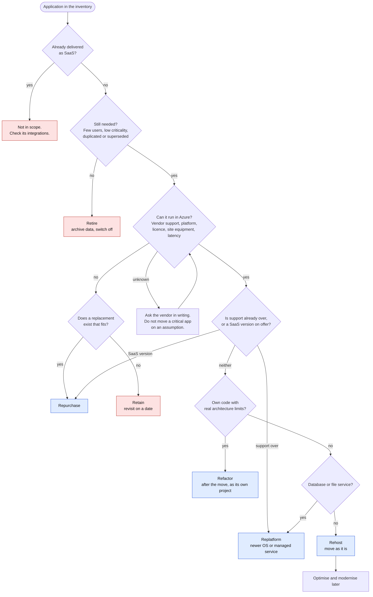

# The six Rs: rules for choosing, and when each is wrong

A disposition (or "R") says what will happen to an application. The six used by this tool are rehost, replatform, refactor, repurchase, retire and retain.

The names are an industry convention, not a standard. Microsoft's current guidance lists eight (rehost, replatform, refactor, rearchitect, retire, replace, rebuild, retain), and AWS's guidance lists seven (adding relocate). This tool keeps six so the decision stays readable. The mapping is below. Checked against Microsoft Learn and AWS Prescriptive Guidance on 11 November 2026; see [sources and verification](sources-and-verification.md).

| This tool | Microsoft's term(s) | Plain meaning |
|---|---|---|
| Rehost | Rehost | Move to Azure virtual machines with no code change ("lift and shift") |
| Replatform | Replatform | Move with small changes to use a platform service, for example a managed database or a newer operating system |
| Refactor | Refactor, rearchitect, rebuild | Change the code or design so it suits the cloud. The tool does not separate the three: size them as projects |
| Repurchase | Replace | Drop the application and adopt a different product, usually SaaS |
| Retire | Retire | Switch it off and deal with the data |
| Retain | Retain | Leave it where it is, for now, with a date to revisit. Also used for applications that are already SaaS and so need no move |

The [decision flow](diagrams/decision-flow.png) shows the questions in plain order. The tool scores rather than walks the flow, so that several weak signals can add up and so that every point is visible. See [disposition rules](disposition-rules.md).

## Rehost

**Choose when** the vendor supports the product in the cloud, the platform is current, the application is stable or critical, and speed or a hard date matters more than running cost. For large estates, guidance from the major providers favours rehost and replatform first and modernising afterwards.

**Rule of thumb in this tool:** supported in the cloud (+1), baseline (+2), critical (+1), stable in-house code (+1).

**Wrong when:**

- support for the operating system or product has already ended. The risk moves with the machine. Rehost is acceptable only as a dated stopgap
- the licence ties the software to hardware or to a site
- it needs a very low round-trip time to equipment that stays on site
- the cost case depends on shrinking, and a like-for-like virtual machine costs about the same as today (see [cost model](cost-model.md))
- nobody can say what it depends on, so a rehost breaks something unseen

## Replatform

**Choose when** a small change removes a real burden: a database that can move to a managed service, a file server that can become a managed file or collaboration service, an operating system that must be upgraded anyway, a web application that can run on a platform service.

**Rule of thumb in this tool:** databases (+3), file services (+3), shared platform services (+2), support ended (+3), actively changed in-house code (+3).

**Wrong when:**

- the application depends on features or settings the managed service does not offer. Test compatibility first
- the change needs vendor approval that has not been given
- the team has no time to test, so a "small change" becomes the largest risk in the wave
- it is used as an excuse to start a modernisation project inside a migration wave

## Refactor

**Choose when** the organisation owns the code, the application changes often, it has real limits (scaling, accumulated technical debt) that the business feels, and the benefit justifies a project of its own.

**Rule of thumb in this tool:** only for in-house custom code (a package scores -4). Notes naming architectural limits add +4.

**Wrong when:**

- you do not control the source code
- the application is stable and the only reason is fashion
- it is bundled into the migration programme, where it delays every wave behind it. Move first, then modernise as a separate funded project
- there is no team that will own the result

## Repurchase

**Choose when** a product that fits the process exists (often the vendor's own SaaS version), the application is a commodity function, or the vendor will not support the cloud and the platform is out of date.

**Rule of thumb in this tool:** vendor does not support the cloud (+3), a SaaS version exists (+4), support ended (+2).

**Wrong when:**

- the process is a source of competitive advantage and the product would force a worse one
- data migration, integrations and retraining have been priced at nothing
- the replacement has not been shortlisted. "Repurchase" without a product is a placeholder
- subscription cost over several years has not been compared with running the current one

## Retire

**Choose when** few people use it, it is not critical, it is superseded or duplicated, and the owner agrees to archive or delete the data.

**Rule of thumb in this tool:** low users and low criticality (+5), notes saying superseded or unused (+4). A critical application scores -4 against retiring.

**Wrong when:**

- hidden dependants exist: a monthly job, an audit look-up, a customer report. Check network flows and ask finance and compliance
- legal or regulatory retention applies to the data and no archive has been planned
- the owner has not agreed. A retirement is a business decision, so the tool always marks it for review

## Retain

**Choose when** the application is already SaaS (nothing to move), the vendor will not support the cloud and there is no replacement yet, the platform cannot run as a standard virtual machine, the application is bound to equipment on a site, the licence forbids it, or the cost of moving is higher than the benefit. Retain with a date to look again, not as a permanent parking space.

**Rule of thumb in this tool:** SaaS already (decides), non-standard platform (+5), site-bound equipment (+4), vendor says no (+3), restrictive licence (+2).

**Wrong when:**

- it is the default for everything uncomfortable, so the estate never gets smaller
- a retained application depends on moved ones (or the reverse) and nobody has designed or sized the hybrid link. The tool lists every such link as a warning
- the shared costs behind it (data centre, hardware, support contracts) do not shrink, so staying and moving both cost more than planned
