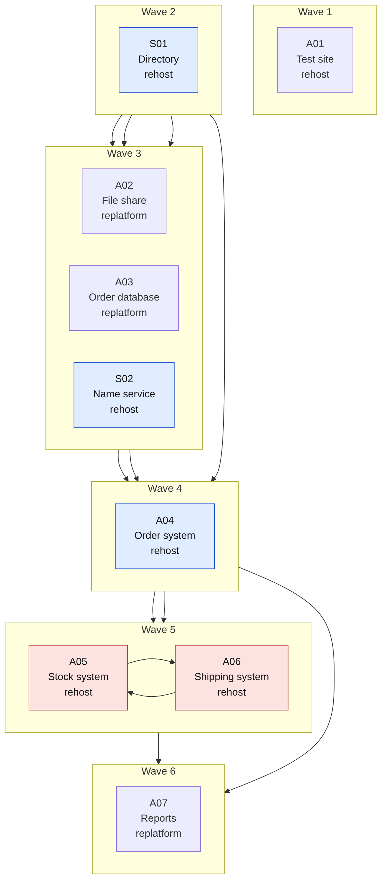

# Wave planning

The `waves` command turns the dispositions and the dependency column into an ordered set of migration waves. This page describes exactly what it does, why, and where it stops.

The picture is a real output for [`diagrams/wave-example.csv`](diagrams/wave-example.csv) with a wave size limit of 4. An arrow runs from a dependency to the application that needs it. Blue boxes are shared services, red boxes are a circular dependency that moves together. The machine gateway in that file is retained on premises, so it is not in any wave.

## Method

1. **Who is scheduled.** Only applications whose disposition is rehost, replatform, refactor or repurchase, and which are in scope. Retired, retained and already-SaaS applications are not in waves. Links to them are reported (see warnings).
2. **Circular dependencies.** The tool finds strongly connected components of the dependency graph (Tarjan's algorithm, run iteratively so large inventories are safe). Every loop is reported with one concrete path, for example `APP026 -> APP027 -> APP026`. The members of a loop are treated as one unit and always placed in the same wave. If such a unit is bigger than the wave size limit it sits alone in a wave and a warning says so.
3. **Dependency order.** By default a unit's dependencies are placed in a strictly earlier wave. Set `allow_dependency_in_same_wave` to true to let an application share a wave with what it depends on.
4. **Shared services first.** Among units that are ready, a shared service goes first. An application counts as a shared service if its technology class is in `shared_service_classes` (default: `platform_service`) or at least `shared_service_min_dependents` (default 3) other applications depend on it.
5. **Then the longest chains.** After shared services, units with the longest tail of dependants go first, so that the programme does not finish with a long chain of single-application waves. Lower criticality goes before higher, then application id, so results are stable.
6. **Constraints.**
   - `max_wave_size`: at most this many applications in a wave (default 8). Override on the command line with `--max-wave-size`.
   - Critical applications (`critical_min_criticality`, default 4 and above) are not placed before wave `critical_min_wave` (default 2). A loop containing a critical application counts as critical.
   - `min_wave_by_disposition`: refactor and repurchase are not placed in wave 1 by default, because they carry the most change.
7. **Empty first wave.** If every candidate is critical or depends on one that is, wave 1 is left empty and the plan says so. Use that wave to prove the landing zone with a low-risk pilot that is outside the inventory. The tool does not break the critical rule to fill it.

The same input always gives the same waves, whatever the order of rows in the CSV.

## What the output tells you

- `waves.csv`: wave, application, disposition, criticality, whether it is a shared service, which loop it belongs to, what it depends on.
- `waves.json`: the same, plus the settings used, loops, applications not scheduled and warnings.
- `waves.mmd`: a Mermaid diagram of the plan. Links to very widely used shared services are not drawn, because they would hide the structure, and a comment in the file says how many were left out.
- **Links across the on premises and Azure boundary after each wave.** After wave N, how many dependency links join an application that has moved to one that has not (in either direction). This is the number of paths the hybrid connection must carry, and it is the figure to size and test connectivity against. It never reaches zero if anything is retained.

## Warnings and what to do with them

| Warning | Meaning | Action |
|---|---|---|
| Circular dependency | A set of applications each need another in the set | Confirm each link is a real runtime link. A nightly feed can often be loosened. Otherwise plan one joint cutover and rollback |
| X depends on Y, which stays on premises | A moved application calls something that will never move | Test latency and bandwidth. Decide whether Y really should stay |
| X stays on premises but depends on Y (wave N) | Once Y moves, X calls into Azure | Same test. Include X in the wave test plan |
| X depends on Y, proposed for retirement | The retirement would break X | Remove or replace the dependency first |
| Y is proposed for retirement but X depend on it | Same, seen from the other side | Do not retire Y yet |
| Cycle group larger than the wave size limit | It will exceed the limit | Accept it, raise the limit, or break the loop |
| Wave 1 has no application | Nothing eligible under the critical rule | Use it for a landing zone pilot |

## Honest limits

- **A dependency list is only as good as its source.** Verify it with network flow data or discovery output. Azure Migrate's dependency analysis exists for this purpose; this tool does not replace it.
- **Any order leaves a window of hybrid running.** If a dependency moves first, its callers reach it across the link until they move. If callers move first, they reach back. The plan can shrink that window by keeping tightly coupled applications in the same wave. The tool offers `allow_dependency_in_same_wave` and loop grouping for this, and the boundary link count shows what remains.
- **Wave size is a count of applications, not effort.** A wave of eight small applications is not like a wave of eight large ones. Use the limit as a proxy, and review every wave with the people who will do the work.
- **No dates.** The tool orders waves. It does not know team capacity, change freezes, financial close, holidays or contract end dates. Microsoft's guidance on wave planning makes the same point: size waves by complexity and team capacity, plan the next wave in detail and keep later ones high level, and avoid business-critical periods. Put your calendar over the plan.
- **Critical is not the same as risky.** A non-critical application with a complex dependency can be a worse early candidate than a simple critical one. The rules use criticality because it is recorded; use judgement beyond it.
